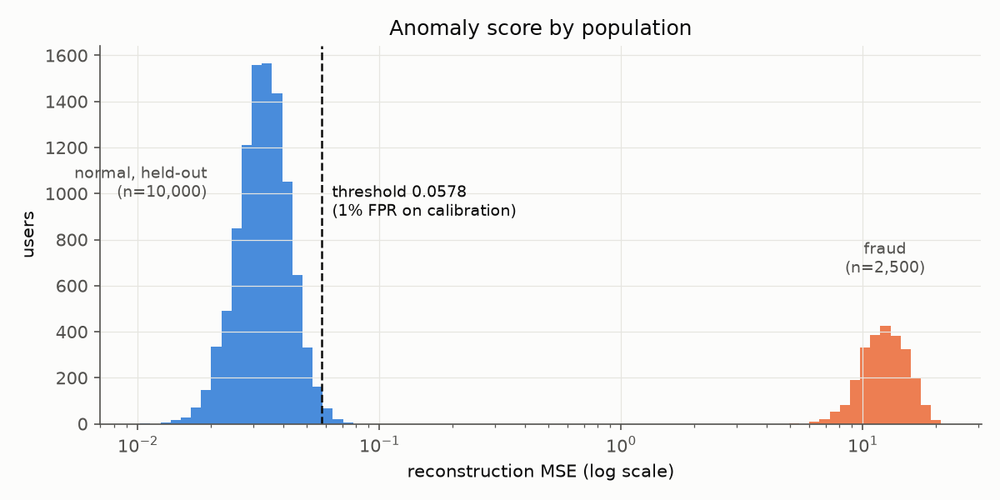

# Financial transactions anomaly detection

Unsupervised fraud detection on bank-style user profiles with a dense **autoencoder** trained only on normal users. Users the model cannot reconstruct well are flagged for review.

This is a rebuild of an autoencoder fraud detector originally written in 2025. The trained model is the **original, unmodified** 2025 checkpoint. Everything around it was re-engineered:
- reproducible preprocessing;
- a leak-free evaluation;
- a calibrated threshold;
- a working, tested API;
- full documentation of the EDA, decisions and limitations.



## Results at a glance

| | |
|---|---|
| Recall on 2,500 held-out synthetic fraud users | **100%** |
| False-positive rate on 10,000 held-out normal users | **1.04%** (threshold set for 1% on separate calibration data) |
| Precision at an assumed 1% fraud prevalence | 49% |
| ROC-AUC | 1.000. An IsolationForest baseline scores 0.99999, so the synthetic benchmark is saturated ([why](docs/REPORT.md#7-results)) |
| Fixed hackathon bug | The original API flagged **4%** of a 100%-fraud upload; the rebuilt pipeline flags 100% |

**Honest caveat:** the data is synthetic, and fraud was generated from ranges that are largely disjoint from normal users. The numbers prove the pipeline is correct, not that it would work on real bank data. See [limitations](docs/REPORT.md#9-limitations-and-next-steps).

## Documentation

| Document | What's in it |
|---|---|
| [`docs/REPORT.md`](docs/REPORT.md) | Full technical report: framing, data, EDA, feature engineering, model, evaluation design, results, serving, limitations |
| [`docs/DECISIONS.md`](docs/DECISIONS.md) | Decision log (ADRs): each choice with the alternatives considered and the reasoning |
| [`docs/MODEL_CARD.md`](docs/MODEL_CARD.md) | Model card: intended use, metrics, limitations, ethics |
| [`notebooks/01_eda.ipynb`](notebooks/01_eda.ipynb) | Exploratory data analysis, executed, with findings and decisions |
| [`notebooks/02_evaluation.ipynb`](notebooks/02_evaluation.ipynb) | Evaluation walkthrough: thresholds, checkpoint comparison, attribution, ablation probes |

## Pipeline

```
data/*.csv ─► features.Preprocessor ─────────────────────► model (night_4.h5) ─► MSE score ─► > threshold? ─► flagged users
              validate → drop IDs → label-encode            52→256→128→64→32→…→52           (threshold.json,      + top features
              (frozen vocab) → MinMax (frozen scaler)                                        1% FPR on calibration)
```

## Repository layout

```
├── src/fraud_ae/
│   ├── config.py        paths, frozen input contract, feature groups
│   ├── features.py      preprocessing (fit once, apply only; unseen → −1)
│   ├── model.py         model loading, scoring, Detector (with per-user explanations)
│   ├── thresholds.py    threshold rules (hackathon rules plus the adopted quantile rule)
│   └── evaluate.py      end-to-end evaluation → reports/metrics.json, docs/figures, models/threshold.json
├── api/app.py           FastAPI service
├── scripts/
│   ├── build_encoders.py            recovers the lost label encoders and verifies them against scaler.pkl
│   └── generate_synthetic_data.py   documented, seeded data generator
├── models/              night_4.h5, scaler.pkl, label_encoders.json, threshold.json, legacy_checkpoints/
├── data/                training normals (gzipped, original) and fraud users
├── notebooks/           01_eda, 02_evaluation (executed)
├── reports/metrics.json
├── tests/               pipeline and API tests
└── legacy/              original hackathon notebooks and API, kept verbatim for provenance
```

## Quickstart

Requires Python 3.10-3.12.

```bash
python -m venv .venv && source .venv/bin/activate
pip install -r requirements.txt
```

Recover and verify the encoders. This step is optional; the output is already committed.

```bash
PYTHONPATH=src python scripts/build_encoders.py
```

Run the full evaluation. It takes about 20 seconds on CPU and regenerates the metrics, figures and threshold.

```bash
PYTHONPATH=src python -m fraud_ae.evaluate
```

Run the tests:

```bash
pytest -q
```

Serve the API:

```bash
PYTHONPATH=src uvicorn api.app:app --port 8000
```

Score the fraud file against the running API:

```bash
curl -F file=@data/fraud_night_1.csv localhost:8000/detect_anomalies/
```

Example response (abridged):

```json
{
  "rows": 2500,
  "threshold": 0.0578,
  "flagged_users": ["cb0778f7-…", "…"],
  "details": [{"user_id": "cb0778f7-…", "score": 13.64582, "top_features": ["chargeback_ratio", "number_of_refunds", "phone_number_prefix"]}],
  "unseen_category_rate": {"email_domain": 0.7236, "browser_type": 0.4952, "most_active_community": 1.0, "...": 0.0}
}
```

## Key engineering decisions (details in [DECISIONS.md](docs/DECISIONS.md))

- **The model is not retrained.** The original weights are kept for provenance, and all improvements are around the model (ADR-001).
- **The lost `label_encoders.pkl` was recovered exactly.** Re-encoding the training data reproduces all 52 min/max values of the original scaler (ADR-003).
- **Preprocessing is never re-fitted at inference time.** This fixes the hackathon's train/serve skew (ADR-006).
- **The threshold is set from normal calibration data at a 1% target FPR.** Alert volume becomes a business knob instead of a magic number (ADR-005).

## Credits

Originally written in 2025. The original code is preserved in [`legacy/`](legacy/).
