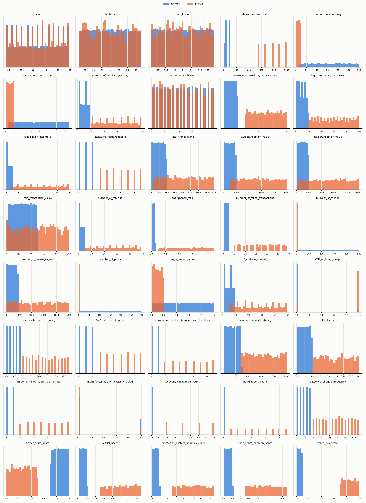
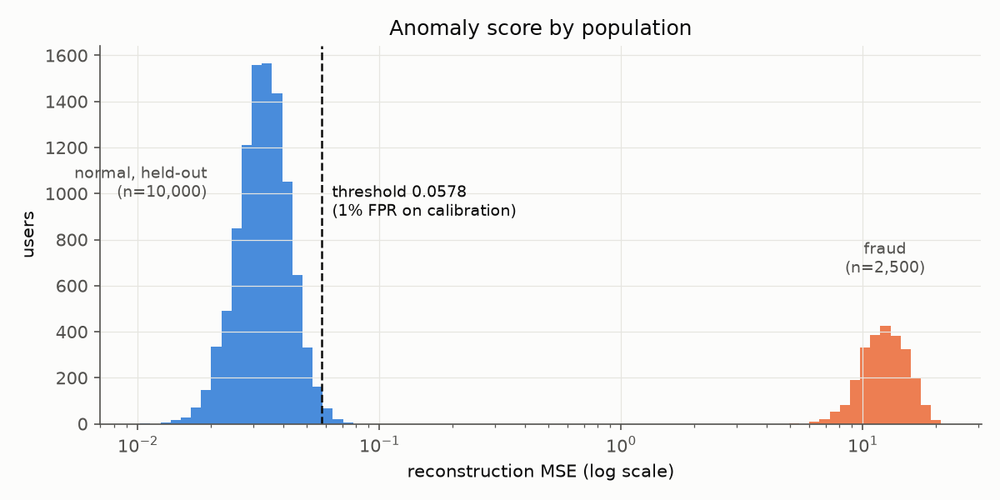
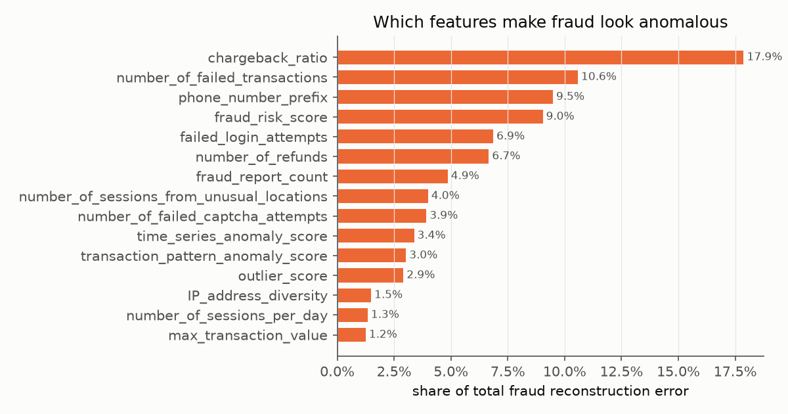
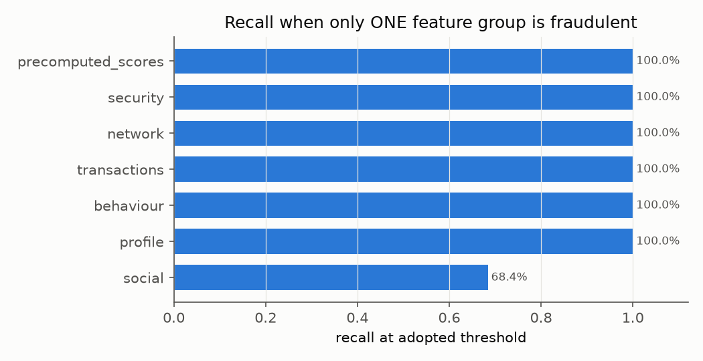

# Technical report: unsupervised fraud detection with an autoencoder

*This report describes the rebuilt version of an autoencoder fraud detector originally written in 2025. The model weights are the original 2025 weights. Everything around them (data handling, preprocessing, thresholding, evaluation, serving, documentation) was re-engineered in November 2026.*

Contents
1. [Problem framing](#1-problem-framing)
2. [Data](#2-data)
3. [Exploratory data analysis](#3-exploratory-data-analysis)
4. [Feature engineering and preprocessing](#4-feature-engineering-and-preprocessing)
5. [Model](#5-model)
6. [Evaluation methodology](#6-evaluation-methodology)
7. [Results](#7-results)
8. [Serving](#8-serving)
9. [Limitations and next steps](#9-limitations-and-next-steps)
10. [What changed from the hackathon code](#10-what-changed-from-the-hackathon-code)

---

## 1. Problem framing

**Business problem.** A bank wants to surface suspicious user accounts for analyst review. Confirmed fraud labels are rare, delayed (chargebacks arrive weeks later) and biased toward the fraud patterns the bank already knows.

**ML framing.** This is **unsupervised anomaly detection**, also called novelty detection. We learn what *normal* users look like and score every user by how far they deviate. Three reasons we chose this over a supervised classifier:

| | Supervised classifier | Anomaly detector (chosen) |
|---|---|---|
| Labels needed | Many, for every fraud type | None (normal data only) |
| New fraud patterns | Missed until labelled | Flagged if they deviate from normal |
| Output | P(fraud) | Anomaly score; threshold sets alert volume |
| Weakness | Label delay and bias | Flags *unusual* users, not only *fraudulent* ones |

The team also built a supervised XGBoost model on PaySim transactions for the Django staff portal. That model is out of scope here (see [§10](#10-what-changed-from-the-hackathon-code)).

**Why an autoencoder?** The original brainstorm (`legacy/ideas.txt`) started from k-means. An autoencoder improves on clustering for this task in three ways:
- It gives a *continuous* per-row score (reconstruction error) instead of a cluster assignment.
- It handles mixed feature types after scaling.
- It can model non-linear joint structure.

Whether that last advantage actually matters depends on the data. [§3](#3-exploratory-data-analysis) shows that here it does not.

**Success criteria.**
- **Primary operating metric: recall at a fixed false-positive rate.** The FPR is set by analyst capacity. We assume 1% of normal users can be reviewed.
- **Secondary:** ROC-AUC and average precision, plus precision re-weighted to a realistic 1% prevalence.

## 2. Data

All data is **synthetic**. It was generated with Faker and NumPy during the hackathon; `scripts/generate_synthetic_data.py` is a seeded port of the generator.

| File | Rows | Role | Notes |
|---|---|---|---|
| `data/non_fraud_night_1.csv.gz` | 100,000 | Train (80k) / calibration (10k) / test (10k) | The exact file `night_4.h5` was trained on (SHA-256 `19813ae8…`, uncompressed) |
| `data/fraud_night_1.csv` | 2,500 | Test positives only | Never used for training or threshold selection. Has a stray `Unnamed: 0` index column |

**Schema.** Each file has 53 columns: `user_id` plus 52 features in 7 semantic groups:

| Group | Count | Examples |
|---|---|---|
| Profile | 11 | `age`, `country`, `email_domain`, `phone_number_prefix` |
| Behaviour | 11 | `session_duration_avg`, `failed_login_attempts`, `login_frequency_per_week` |
| Transactions | 8 | `chargeback_ratio`, `number_of_refunds`, `avg_transaction_value` |
| Social | 5 | `number_of_friends`, `engagement_score` |
| Network | 7 | `IP_address_diversity`, `VPN_or_Proxy_usage`, `packet_loss_rate` |
| Security | 6 | `device_trust_score`, `account_suspension_count` |
| Pre-computed scores | 4 | `fraud_risk_score`, `outlier_score` |

The full mapping is in `src/fraud_ae/config.py`.

**How the data was generated.** Each feature is drawn **independently** from a uniform, integer-uniform or categorical distribution. The fraud population uses shifted and mostly **disjoint** ranges and some categories that never appear in normal data, such as `tempmail.com`, `BotBrowser` and `Stolen Card`. Everything in [§7](#7-results) follows from this fact.

## 3. Exploratory data analysis

Full analysis with code: [`notebooks/01_eda.ipynb`](../notebooks/01_eda.ipynb).

| Finding | Evidence | Consequence |
|---|---|---|
| Clean by construction | 0 missing values, 0 duplicate rows, 0 ID overlap | No cleaning step needed. The serving code still validates the schema |
| `user_id` is a random UUID | 100k unique values | Dropped (ADR-002) |
| Two columns are constant 0 in normal data | `account_suspension_count`, `fraud_report_count` | Zero-range columns under MinMax, so any non-zero value lands far out of range. In a real bank these are **post-hoc labels**, so this is leakage |
| Four columns are other models' outputs | `*_score` columns, disjoint ranges | Circular as inputs. We show recall without them (100%) |
| Mis-typed columns | `phone_number_prefix` was parsed as an integer; `account_creation_date` is a string with 1,915 levels | Frozen as trained. v2 fix: categorical prefix, numeric account age |
| High-cardinality noise | `city` has 38,144 levels; `country` has 243 and is independent of lat/long | Frozen. v2: drop |
| Novel fraud categories | 72% of fraud rows have an unseen `email_domain`; 50% have an unseen `browser_type` | Mapped to −1 (ADR-004), a weak signal (see [§7](#7-results)) |
| **Disjoint ranges** | 23 of 40 numeric features put *every* fraud row outside the training range | The benchmark is trivially separable. Results are an upper bound |
| **No correlation structure** | max \|ρ\| between normal features = 0.011 | An AE has no joint structure to learn. It effectively learns per-feature ranges |



## 4. Feature engineering and preprocessing

**Constraint: the model is frozen.** `night_4.h5` expects exactly 52 inputs, in a fixed order, transformed in a fixed way. Feature engineering for this release therefore had two jobs:
1. Reproduce the training-time transform **exactly**.
2. Record, with evidence, what a v2 should change.

Pipeline (`src/fraud_ae/features.py`):

```
CSV ──► validate schema ──► drop IDs ──► label-encode 12 categoricals ──► MinMax scale ──► 52-d float32
            (all 52 cols)   (user_id,     (frozen vocab, unseen → −1)     (frozen scaler.pkl,
                             Unnamed: 0)                                    no clipping)
```

| Step | Decision | Why |
|---|---|---|
| Identifier removal | Drop `user_id`, `account_number`, `transaction_id`, `Unnamed: 0` if present | Identifiers carry no behavioural signal and would let the model memorise rows |
| Categorical encoding | Label encoding with a **frozen** vocabulary recovered from training data | The model was trained this way. One-hot would change the input dimension. Recovery is verified exactly (ADR-003) |
| Unseen categories | −1 | Same convention as the hackathon's `encode_with_fallback`. After scaling it falls slightly below 0, out of range in the "anomalous" direction |
| Scaling | Apply the original `scaler.pkl`; **never refit** | Refitting per batch was the core hackathon bug (ADR-006) |
| Clipping to [0,1] | **Not** done | Out-of-range values are the evidence. Clipping fraud's `chargeback_ratio = 0.9` to 1.0 would hide it |
| Missing / non-numeric | Reject with HTTP 422 | Training data had none, so imputation would be a guess. Fail loudly instead |

**Recovering the lost encoder.** The training notebook saved `label_encoders.pkl`, but the file was lost. sklearn's `LabelEncoder` sets `classes_` to the sorted unique values, so refitting on the same CSV gives the same mapping. `scripts/build_encoders.py` proves this: it encodes the training CSV with the recovered vocabulary and checks that the per-feature min/max equal the values stored in the original `scaler.pkl`. All 52 of 52 match. The vocabulary is stored as JSON (`models/label_encoders.json`) rather than pickle, so it is readable, diffable and safe to load.

**v2 feature set (needs retraining):**
- Drop: the leaky counters, the `*_score` columns, `city`, `country`.
- Convert `account_creation_date` into `account_age_days`.
- One-hot the low-cardinality categoricals, plus an `is_unseen` flag for each.
- Treat `phone_number_prefix` as a categorical.
- Add log transforms for count features. This matters only for real, skewed data.

## 5. Model

| | |
|---|---|
| Architecture | Dense autoencoder 52 → 256 → 128 → 64 → **32** → 64 → 128 → 256 → 52 |
| Activations | ReLU; sigmoid output (inputs are scaled to [0, 1]) |
| Regularisation | L1 activity regulariser (1e-5) on the first encoder layer |
| Loss / optimiser | MSE, Adam with learning rate 1e-3, batch size 16 |
| Callbacks | `EarlyStopping(patience=5, restore_best_weights)`, `ReduceLROnPlateau(0.5, patience=3, min_lr=1e-6)` |
| Training data | 80,000 normal users (`train_test_split(test_size=.2, random_state=42)`) |
| Training log | val_loss fell from 0.0505 (epoch 1) to 0.0395 (epoch 10) and then plateaued. The log in the notebook is truncated after epoch 10 |
| Parameters | 113,620 |
| Anomaly score | Mean squared reconstruction error across the 52 features |

Full model card: [`MODEL_CARD.md`](MODEL_CARD.md). The training code is preserved verbatim in `legacy/train_autoencoder_original.ipynb`.

## 6. Evaluation methodology

```
non_fraud_night_1 (100k) ── split(seed 42, as in training) ─┬─ 80k train  (model saw these)
                                                            └─ 20k val ── split(seed 0) ─┬─ 10k calibration → choose threshold
                                                                                         └─ 10k test normals ┐
fraud_night_1 (2.5k) ────────────────────────────────────────────────────────────────────────────────────────┴─ test set
```

- **No leakage into the threshold.** The threshold is chosen on calibration normals only, with no fraud labels. That is how it would be set in production before any labels exist.
- **Same validation rows as training.** Reproducing the original split means the 20k evaluation normals are the same rows Keras used for `validation_data`, so the model never fit on them.
- **Realistic precision.** The test set is 20% fraud, so raw precision would be inflated. We report precision at an assumed 1% prevalence:
  `precision = recall·p / (recall·p + FPR·(1−p))`.
- **Baselines and probes.** We train no new autoencoder. The evaluation adds:
  - an IsolationForest on the same features;
  - a comparison of the five surviving hackathon checkpoints;
  - **counterfactual probes**: overwrite one feature group (or one feature) of a normal user with a fraud user's values, and check whether the model alerts. This measures which signals are sufficient without retraining.
- Everything is reproducible with `python -m fraud_ae.evaluate`, which writes `reports/metrics.json` and all figures.

## 7. Results

Walkthrough with figures: [`notebooks/02_evaluation.ipynb`](../notebooks/02_evaluation.ipynb). Raw numbers: [`reports/metrics.json`](../reports/metrics.json).



**Headline (adopted threshold 0.0578, set at 1% FPR on calibration):**

| Metric | Value |
|---|---|
| Recall on fraud | **100%** (2,500 / 2,500) |
| FPR on unseen test normals | **1.04%** (target 1%, so well calibrated) |
| Precision at 1% prevalence | 49% |
| ROC-AUC / average precision | 1.000 / 1.000 |
| IsolationForest baseline ROC-AUC | 0.99999 |
| Normal score: median / p99 | 0.033 / 0.058 (train ≈ test, so no overfitting) |
| Fraud score: median | 12.3 (about 370× the normal median) |

**Interpretation.** The benchmark is **saturated**:
- An untuned IsolationForest is just as good.
- 28 of 52 single features alone flag most fraud.

The AUC tells us the pipeline is *correct*, not that the model is *good*. The decision with real operational impact is the threshold.

**Threshold rules** (all fitted on calibration normals, all 100% recall):

| Rule | Origin | Threshold | Test FPR | Precision @1% |
|---|---|---|---|---|
| Fixed 0.05 | `third.ipynb` | 0.0500 | 4.30% | 19% |
| 96th percentile | `api.py` | 0.0506 | 3.80% | 21% |
| Tukey Q3 + 1.5·IQR | `third(1).ipynb` | 0.0555 | 1.62% | 38% |
| Median + 3·MAD | `third(1).ipynb` | 0.0496 | 4.51% | 18% |
| Skew-adjusted percentile | `third(1).ipynb` | 0.0472 | 6.75% | 13% |
| **Quantile at 1% FPR** | **adopted** | **0.0578** | **1.04%** | **49%** |

The adopted rule is the only one where the alert rate is an explicit, controllable business parameter (ADR-005).

**Checkpoint comparison** (same preprocessing for all; the older checkpoints' original preprocessing did not survive, so treat these as indicative):

| Checkpoint | Bottleneck | Params | Normal MSE | Test FPR @ 1% cal. quantile |
|---|---|---|---|---|
| **night_4.h5** (shipped) | 32 | 113,620 | **0.034** | **1.04%** |
| night_3.h5 | 10 | 8,402 | 0.067 | 1.14% |
| night_2.h5 | 10 | 6,342 | 0.069 | 1.17% |
| night_1.h5 | 8 | 4,764 | 0.078 | 1.26% |
| autoencoder_fraud_detection.h5 (old API) | 16 | 12,036 | 0.153 | 1.18% |

`night_4` reconstructs normal users best, so it has the tightest normal score distribution and the best-calibrated FPR. It is kept.

**What the model relies on:**

 

- Six of the seven feature groups are each *individually sufficient* for 100% recall. The detector is highly redundant.
- With the four circular `*_score` columns replaced by normal values, recall is **still 100%**. The model does not depend on them.
- Unseen categorical values contribute almost nothing on their own. Label encoding with a −1 fallback mutes novelty. This is the strongest argument for one-hot encoding in v2.

## 8. Serving

`api/app.py` (FastAPI):
- `GET /health` returns the model name and threshold.
- `POST /detect_anomalies/` takes a multipart CSV with the 52 feature columns plus `user_id`. It returns:
  - `flagged_users`;
  - per-user `score` and the `top_features` with the largest reconstruction error, as a simple explanation for analysts;
  - `unseen_category_rate`, a cheap per-request drift monitor.
- Errors: malformed input returns 400 or 422, oversized files (> 50 MB) return 413.
- Scoring is **row-independent**: a user's score does not depend on who else is in the upload. A test enforces this.

## 9. Limitations and next steps

1. **Synthetic, independent, disjoint data.** The numbers are an upper bound, and real-world performance is unknown. Real behaviour data is correlated and heavy-tailed, and real fraud mostly sits *inside* normal ranges.
2. **Leaky and circular features** are inside the frozen model's input. Recall does not depend on them, but they should not exist in v2.
3. **Label encoding** imposes a fake order and mutes categorical novelty.
4. **Anomalous ≠ fraudulent.** Legitimate but unusual users (new business accounts, travellers) will be flagged. The threshold should be owned by the fraud-ops team and revisited with labelled outcomes.
5. **No drift monitoring beyond the unseen-category rate.** Production would track the score distribution (for example, PSI against the calibration set) and the alert rate over time.
6. **Legacy file formats.** The model uses legacy HDF5 and the scaler is a pickle. Both are trusted artifacts in this repo; do not load such files from untrusted sources.

**Recommended v2 (requires retraining), in priority order:**
1. Build a *hard* evaluation set where fraud overlaps normal ranges and only the joint pattern differs.
2. Apply the v2 feature set from [§4](#4-feature-engineering-and-preprocessing).
3. Benchmark the AE against IsolationForest and a per-feature robust z-score rule, and keep the AE only if it wins on the hard set.
4. Save as `.keras` plus a single sklearn `Pipeline` so that preprocessing and model ship as one artifact.
5. Track experiments (for example with MLflow).

## 10. What changed from the hackathon code

| Hackathon (2025) | Rebuilt (this repo) |
|---|---|
| `api.py` crashed: missing imports, undefined `df_scaled`/`df`, read `user_id` after dropping it | Working service with tests |
| Encoders and scaler **re-fitted per request** (train/serve skew) | Frozen artifacts, applied only |
| Threshold = 96th percentile *of each batch*: flags 4% of any upload | Fixed threshold from calibration normals at 1% FPR |
| On the demo upload of 2,500 fraudsters, the old pipeline flags **4%** of them | The rebuilt pipeline flags **100%** |
| API loaded `autoencoder_fraud_detection.h5`, not the model the notebook trained | Serves `night_4.h5`, the best checkpoint |
| `label_encoders.pkl` lost | Recovered exactly and verified, stored as JSON |
| No held-out evaluation and no fraud metrics | Leak-free split, threshold study, baselines, probes |
| No dependency list | `requirements.txt` |

On a realistic mixed batch (2,000 normal + 50 fraud), the old per-batch pipeline still catches 49 of 50 fraudsters, but it always flags 4% of the batch (82 users, 33 of them false alarms). The rebuilt pipeline catches 50 of 50 and flags about 1% of normal users. The old pipeline's real failure mode was **fraud-heavy batches and alert volume**, not mixed batches.

Not carried over: the team's Django staff portal and XGBoost transaction model. Its URL routing was disabled, its model files were missing, and it contained a hard-coded Django secret key, a seeded plaintext password and a SQLite database with password hashes, so it is excluded from this public repository.
